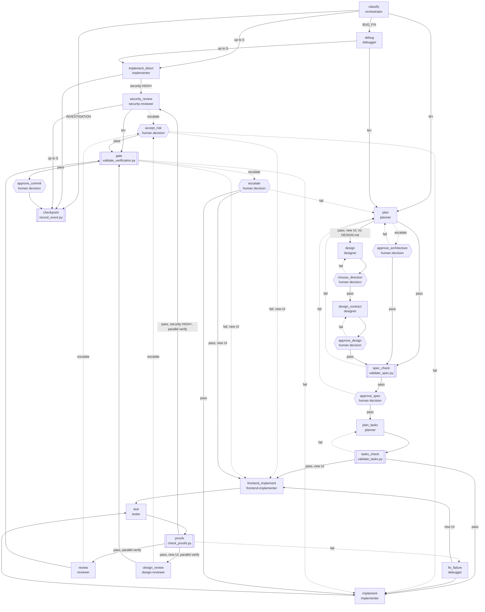

# Spec-driven agent system

The system lives in the agent-workbench plugin and only writes a timeline and state inside a project after `/init-agent-system`.

Principle: do not optimize code generation. Optimize traceable, verifiable, and safe development.

Intent → Requirement → Specification → Decision → Task → Implementation → Evidence → Review → State.

## Layers

| Layer | Where | Responsibility |
| --- | --- | --- |
| Rules | `rules/` | Permanent principles and limits. `00`, `01`, `economia-de-tokens`, and `mcp-triagem-obrigatoria` always; `02`–`08` per phase. In Claude Code, `00`–`08` arrive through the project `CLAUDE.md` |
| Skills | `skills/` | Procedures (`/feature`, `/code-review`, `/security-review`...) |
| Agents | `agents/` | Roles with an input and output contract ([`docs/contracts.md`](docs/contracts.md)) |
| Workflows | adaptive table in `agents/orchestrator.md` | Sequence by class, complexity, and risk |
| Scripts | `agent-system/scripts/` | Deterministic validation and operations ([`docs/cli.md`](docs/cli.md)) |
| Hooks | `hooks/hooks.json` (Cursor), `hooks/claude-hooks.json` (Claude Code) | Fail-open observability: timeline and session context. Both call the same `hook.py`, which translates the Claude Code payload to the Cursor shape |
| Evals | `agent-system/evals/` | Deterministic fixtures for the gates |
| References | `skills/security-best-practices/references/` | Per-stack knowledge, loaded on demand |

Decisions: [ADR-0001](../docs/architecture/ADR/0001-formato-dos-artefatos-rastreaveis.md) (format), [ADR-0002](../docs/architecture/ADR/0002-provas-fingerprint-e-politica-de-comandos.md) (proofs and commands), [ADR-0003](../docs/architecture/ADR/0003-papeis-de-verificacao-e-seguranca.md) (roles).

## Adaptive flow

```text
request → class + complexity + security risk
        → spec (REQ/AC, EARS) → validate_spec --require-approval      M+
        → ADR                                                          only for an architecture decision
        → tasks (TASK/TEST) → validate_tasks                           M+
        → implementer, one task at a time
        → security-reviewer                                            HIGH/CRITICAL risk
        → tester → check_proofs (real exit code + fingerprint)         M+
        → reviewer with Verification Audit                             M+
        → validate_verification (completion gate)                      M+
        → checkpoint + state
```

XS: do it directly. S: do it directly with the test that proves the change. No gate is mandatory for XS and S.

The same flow is declared as data in [`workflow.json`](workflow.json): agent, script, and human nodes, conditional edges, a parallel review group that joins at the gate, and `limits.max_revisions`. `validate_workflow.py` checks it and `next_step.py` routes from it ([`docs/cli.md`](docs/cli.md)). The diagram below is generated by `validate_workflow.py --mermaid`; a test fails when it drifts. Dotted arrows are `fail` or `escalate` results; hexagons are human decisions; double boxes are scripts.

<!-- workflow:begin -->

<!-- workflow:end -->

## Traceability

IDs `REQ`, `AC`, `ADR`, `TASK`, `TEST`, `PROOF`, `FIND`, and `SEC`, each as a heading that starts with the ID, linked by `- Requirements:`, `- Acceptance:`, `- Verification:` lines. One slug per feature, the same file name in each `layout.json` folder. Format: [`docs/artifacts.md`](docs/artifacts.md).

EARS is recommended for behavioral requirements; a technical requirement can be structured natural language. The scripts check structure. Whether the business rule makes sense remains with the planner, the reviewer, and the user.

## Deterministic validation

| Script | Question it answers |
| --- | --- |
| `validate_spec.py` | Does the spec have unique, linked REQs and ACs, with assumptions, questions, and approval? |
| `validate_tasks.py` | Does each task have links, verification, completion, valid dependencies, and evidence when `done`? |
| `check_proofs.py` | Do the TESTs really pass? Records stdout, stderr, exit code, time, and fingerprint |
| `validate_verification.py` | Can it be declared done? Tested criteria, proofs of the current code, review, security, findings, and tasks |

Common exit codes: `0` ok, `1` gate failed, `2` configuration. `--json` and `--strict` on all.

A proof does not require a commit. The fingerprint (the content of each project file, excluding `.cursor/` and the Markdown of the doc folders; it does not depend on HEAD) says whether the code changed after the test, and stays the same after committing the same content. `check_proofs.py` runs without a shell, only allowed executables, refuses known install and publish subcommands (best effort, by name; not a sandbox), refuses inline code on a best-effort basis (`python -c`, `node -e`, also behind `uv run` and similar), and terminates the process tree on timeout. A TEST points to the runner or to a project test file. Proofs live in `.cursor/agent-system/proofs/`, are local, and must not be versioned.

## Security

- Rule `08-security-engineering`: short limits (deny by default, validation, secrets, upload, integrations, errors, and logs).
- `security-best-practices` skill: secure coding with ten per-stack references (PHP, Laravel, Express, React, Next.js, Python, FastAPI, Django, ASP.NET Core, Spring). The init records in `layout.json` which references apply to the project.
- `/security-review` skill and the `security-reviewer` agent: an `SEC-NNN` report with severity CRITICAL to INFORMATIONAL, confidence, and classification (confirmed, likely, suspected, hardening, accepted risk). Report first; a fix only with authorization.
- Security risk is a dimension separate from complexity (rule `01`). HIGH and CRITICAL make the security review mandatory at the gate.

## Lessons learned

`lessons.py` writes to `.cursor/agent-system/lessons.json` (source of truth) and generates `LESSONS.md`. Agents propose (`candidate`); only the user confirms or rejects. Session start injects up to five confirmed titles; the rest is loaded by category (`list --status confirmed --category X`). Text that looks like a secret and duplicates are refused.

Global lessons: `lessons.py promote --id LESSON-NNN` copies a confirmed project lesson to `$AGENT_WORKBENCH_HOME/lessons.json` (default `~/.agent-workbench/`), created on first use; `add`, `list`, `confirm`, and `reject` take `--scope global`. Promotion and global confirmation are user decisions and refuse a text with the project's path or folder name, any absolute path, a URL, or a secret; the copy keeps no evidence or origin. Session start adds up to three global titles after the project's, skipping any with the same normalized title as a project lesson. `"global_lessons": false` in `layout.json` (kept across inits) turns the global store off for that project.

## Metrics

`metrics.py` reads the timeline and reports, per agent, runs, total and median time, response size, and tokens, and per feature, gates, failed gates, and revisions until the first pass. It is read only. Tokens come from the Claude Code `SubagentStop` hook, which reads only the usage numbers from the subagent's own transcript; without them the report says `unavailable`, never zero. Contract in [`docs/cli.md`](docs/cli.md).

## Evals

`run_evals.py` runs the fixtures in `evals/fixtures/`: minimal projects that prove the gates' behavior (a complete feature passes, a stale proof fails, HIGH risk requires a review...). Model behavior is not evaluated automatically.

Deferred in this version, for lack of a concrete consumer: aggregate timeline metrics and manual agent evaluation by scenarios and rubrics.

## What is automatic

- Rules, skills, and subagents come in through the plugin.
- Plugin hooks run in every workspace, but write nothing if the project has no `.cursor/agent-system/state.json`.
- In an initialized project, the hooks write to `.cursor/timeline/events.jsonl`: session, subagent, file edit (no content), tool failure, a test recognized in the shell (marked `inferred: true`), and the size of the agent's response. Events are appended under a file lock so parallel subagents do not interleave lines.
- `sessionStart` injects the active task, the next step, the roadmap line, and the confirmed lessons.
- The validators write their own events and update `state.json → verification.<slug>`.

## What depends on a person

- Installing in a project: `/init-agent-system`.
- Approving the spec, architecture, business behavior changes, security, permissions, new infrastructure, and removal of behavior.
- Accepting residual risk (with a justification in the report).
- Confirming or rejecting lessons.
- Commit and push: only when asked.
- Creating a new agent: `/create-agent <name>`.
- Semantic events (spec, ADR, task, review, checkpoint): the agent calls `record_event.py`. The hook does not invent that intent.

## Opening a project

`workspaceOpen` does not install the system and does not change an existing project.

`/init-agent-system` copies the scripts and a `hooks.json` to the project, preserving hooks that already existed (backup in `hooks.json.bak-agent-system`). A local script without the `agent-system-managed` mark that differs from the plugin's is preserved. An existing `state.json` only gains new keys. `overrides` and `proof_allow` in `layout.json` survive a new init. Rules and subagents are not copied, because the plugin already loads them. Cloud Agents do not load the plugin: for them, `--for-cloud` copies rules `00` to `08` and the subagents. Under Claude Code, `--claude` skips `.cursor/hooks.json` and writes the condensed rules into a managed block of `CLAUDE.md`.

## Agents

The main chat is the orchestrator, because of rule `00`. Cursor does not replace the main agent with a subagent. That is why the rule says not to invoke another `orchestrator`. In Claude Code this is a convention carried by the `CLAUDE.md` block, not something enforced by the host.

- `planner` — requirements (EARS), spec, ADR, tasks. No code.
- `implementer` — an already specified task.
- `tester` — tests, evals, and proofs with a real exit code.
- `reviewer` — independent review with a Verification Audit. Does not fix on its own. Absorbs the verifier role (ADR-0003). Declares `tools` without `Edit`.
- `security-reviewer` — security findings with stack references. Does not fix. Declares `tools` without `Edit`.
- `debugger` — reproduces and finds the cause before the patch.
- `designer` — visual identity of a new interface with the user: brief, three rendered directions, `DESIGN.md` and tokens. No production code.
- `frontend-implementer` — one screen bound to `DESIGN.md` and the tokens, with every state and `lint_design.py` clean.
- `design-reviewer` — independent design review against `DESIGN.md`, the brief, and the lint. Does not fix. Declares `tools` without `Edit`.

The `agent-system/agents.json` registry lists only this system's agents and is checked against `agents/*.md` by the tests. Cursor's built-in agents are not in it (the built-in `security-review` is a different agent).

## Commands

Skills with `disable-model-invocation: true` are explicit commands: `/init-agent-system`, `/create-agent <name>`, `/agent-status`, `/timeline`, `/help`, `/security-review`. The others (`/feature`, `/code-review`, `/lessons`...) can also be invoked by name. Full guide: `/help`.

## State

`.cursor/agent-system/state.json` holds the phase, active task, active agent, blocked tasks, open CRs, review, next step, and each gate's result per feature (`verification`). It survives the end of the conversation.

## Roadmap

`docs/progress/ROADMAP.md` is the plan's map: phases, tasks with status (`[x]`, `[~]`, `[ ]`, `[!]`), and the "You are here" line. `/roadmap` shows, creates, updates, or renders the Canvas view. The Portuguese marker "Você está aqui" is still read.

## Timeline

`.cursor/timeline/events.jsonl` is append-only and is the source of truth. Verdicts are also a decision trace: each validator event records the graph node, the artifact paths it read, and the workspace fingerprint, so `timeline_view.py --feature <slug>` shows what each decision was based on and where the code changed between decisions. `/timeline` generates `TIMELINE.md`. Repeated edits to the same file within 20 seconds become a single `FILE_EDIT`. Passwords, tokens (including `--token value`, known prefixes, and credentials in a URL), and file contents are not written. A `.env` or private-key path becomes `[redacted-path]`.

## A project already under way

`/init-agent-system` does not move the PRD, PDR, ADRs, or spec. It records the paths it found in `layout.json`. An old spec without IDs is not migrated or validated; the traceable format arrives with the next M or larger work.

## Tests

```powershell
python agent-system/scripts/test_system.py            # full suite
python agent-system/scripts/test_system.py proofs     # filter by module or function name
python agent-system/scripts/run_evals.py              # only the deterministic evals
```

CI (`.github/workflows/ci.yml`) runs both on Ubuntu and Windows, with Python 3.10 and 3.13.

## Troubleshooting

- Hooks call `python`. If the timeline stays empty, check that `python` resolves to a real interpreter (on Windows the Microsoft Store stub can shadow it). The hooks fail open, so a missing interpreter is silent by design.
- `claude-hooks.json` uses `python -I -S` for a faster start and to ignore user site-packages and `PYTHON*` variables.

## Limitations

- There is no official `agents.json` format in Cursor. The file is this system's registry.
- `afterShellExecution` carries no exit code. The hook's test result is inferred from the text (summary lines of common runners) and marked `inferred`; only `check_proofs.py` produces a deterministic result.
- The `check_proofs.py` policy separates a runner and a test file from an arbitrary command, but is not a sandbox: a test file executes whatever it contains. `--allow-inline` and `--allow-shell` only with the user's authorization.
- Process-tree termination on timeout was tested on Windows and Linux (WSL2); macOS was not tested.
- The validators check structure, not semantics. A test that proves nothing passes the gate (the `weak-test-passes-gate` fixture); the Verification Audit is what catches it.
- Attack-surface detection is by file name and manifest: a hint, not analysis.
- `sessionStart` cannot block the session. The `stop` hook does not send a follow-up; the correction loop is the orchestrator's decision.
- Plugin hooks do not run in Cloud Agents until the project has the hooks copied. Skills and references are not copied to the Cloud.
- There is no automatic evaluation of model behavior.
