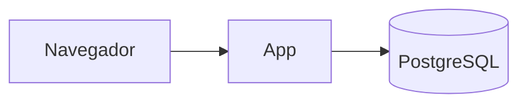

# Arquitetura: agenda de clínicas

## 1. Contexto e atributos de qualidade

Agenda para 200 clínicas; pico de 40 req/s; p95 abaixo de 300 ms.

## 2. Componentes e fronteiras

Monólito com os módulos `agenda` e `clientes`; um módulo não lê as tabelas do outro.

## 3. Dados

PostgreSQL (ADR-0001).

- Migrações: num passo do deploy, compatíveis com a versão anterior.

## 4. Cache

Sem cache: toda leitura é uma consulta indexada abaixo de 20 ms no pico.

## 5. Comunicação

Tudo síncrono; e-mails por job a partir de uma tabela outbox.

- Garantia de entrega: pelo menos uma vez, consumidor idempotente pelo id do lembrete.

## 6. Deploy e infraestrutura

VPS com Docker Compose.

- Ambientes: local e produção.
- Caminho até produção: CI, imagem com o hash do commit, deploy por SSH.

## 7. Observabilidade

Logs JSON com id de correlação; alerta de taxa de erro acima de 1% por 5 minutos.

## 8. Segurança e permissões

RBAC com `recepcao` e `admin`.

- Portas expostas: 443.

## 9. Estágios de escala

### Estágio 0: monólito numa VPS (atual)
- Mudança: desenho acima.

### Estágio 1: banco gerenciado
- Gatilho: CPU do banco > 60% por 7 dias (fonte: métricas do servidor)
- Mudança: PostgreSQL gerenciado
- Custo: mais 30 dólares por mês
- Pré-requisito: string de conexão vinda da configuração

### Estágio 2: duas instâncias
- Gatilho: p95 da agenda > 300 ms por 7 dias (fonte: APM)
- Mudança: duas instâncias atrás do Caddy
- Custo: uma VPS a mais
- Pré-requisito: sessão fora da memória do processo

## 10. Anti-padrões

- Nenhum módulo lê as tabelas de outro.
