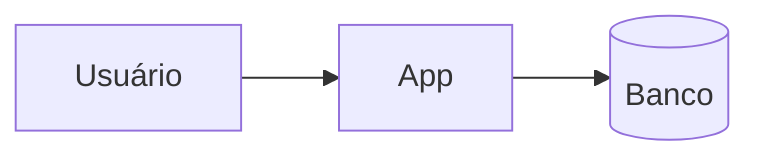
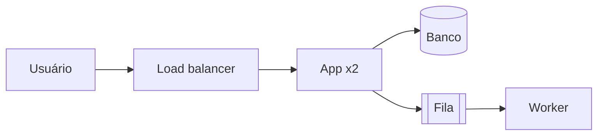

<!-- architecture/options.md. Write the content in the user's language. 2 or 3 options; every pair differs in
     deploy units, data topology, or communication style. Cost ranges are rough, without live price lookup. -->

# Opções de arquitetura: <nome do sistema>

Base: `architecture/brief.md` (aprovado). Carga de pico usada: <N req/s>, armazenamento: <N GB por ano>.

## Opção A: <nome curto>

<Como atende os fluxos principais do brief, em 2 ou 3 frases.>

## Opção B: <nome curto>

<Como atende os fluxos principais do brief.>

## Opção C: <nome curto>

<!-- Optional. In an existing system, one option is "manter a arquitetura atual com ajustes". -->

## Comparação

Custos são faixas aproximadas, sem consulta de preço em tempo real.

| Opção | Custo mensal (faixa) | Complexidade operacional | Pontos únicos de falha | Se a carga dobrar | Deixa de servir quando |
| --- | --- | --- | --- | --- | --- |
| A | <faixa> | <baixa / média / alta: motivo> | <...> | <...> | <carga ou condição> |
| B | <faixa> | <...> | <...> | <...> | <...> |
| C | <faixa> | <...> | <...> | <...> | <...> |

## Recomendação

Opção <X>, recomendada, porque <itens do brief que ela atende com a menor complexidade>.

- Componente que a carga de hoje não exige, se houver: <componente>, exigido por <item do brief>.
- Opção <Y> descartada: <custo> sem <item do brief> que o justifique.
- Opção <Z> descartada: <...>.

<!-- The choice lives only in the front matter (status, choice, chosen_on). An empty choice means the user has not chosen. -->
