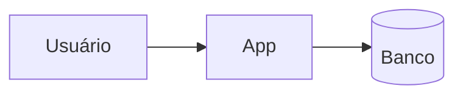

<!-- ARCHITECTURE.md. Write the content in the user's language. Keep the ten headings and the stage labels
     (### Estágio N:, (atual), - Gatilho:, - Mudança:, - Custo:, - Pré-requisito:) literal, in any language.
     A section that does not apply says why in one sentence. Cite ADRs as ADR-NNNN. -->

# Arquitetura: <nome do sistema>

## 1. Contexto e atributos de qualidade

<!-- What the system does and for whom; load today and in 12 months; peak; read/write ratio; p95 target; availability; sensitive data; capacity estimate. -->

## 2. Componentes e fronteiras

<!-- Mermaid diagram; one line per component (responsibility, technology); the dependency rule between modules. -->

## 3. Dados

<!-- Database and why (ADR-NNNN); entities and owners; where consistency is strong and where staleness is accepted; migrations; backup, RPO, RTO. -->

## 4. Cache

<!-- What is cached, where, TTL, invalidation; or the decision not to cache and why. -->

## 5. Comunicação

<!-- Sync and async calls; per async flow: delivery guarantee, idempotency, retries, dead letters; outbox or why not; timeouts. -->

## 6. Deploy e infraestrutura

<!-- Target and why (ADR-NNNN); environments; commit-to-production path; rollback; container rules checked by lint_infra.py. -->

## 7. Observabilidade

<!-- Structured logs with correlation id; RED and USE metrics; tracing or why not yet; alerts with threshold, duration, and who is notified. -->

## 8. Segurança e permissões

<!-- Actors and authentication; authorization model and where enforced; tenant isolation; secrets; exposed hosts and ports; service accounts. See rule 08-security-engineering. -->

## 9. Estágios de escala

### Estágio 0: <nome> (atual)
- Mudança: o desenho descrito nas seções acima.

### Estágio 1: <nome>
- Gatilho: <métrica> <operador> <número e unidade> por <duração> (fonte: <onde é medido>)
- Mudança: <o que muda na arquitetura>
- Custo: <o que adiciona de custo ou de operação>
- Pré-requisito: <o que precisa estar pronto antes>

### Estágio 2: <nome>
- Gatilho: <métrica> <operador> <número e unidade> por <duração> (fonte: <onde é medido>)
- Mudança: <...>
- Custo: <...>
- Pré-requisito: <...>

## 10. Anti-padrões

<!-- What this project must not do, specific to its architecture, plus the lint_infra.py P0 rules that apply. -->
