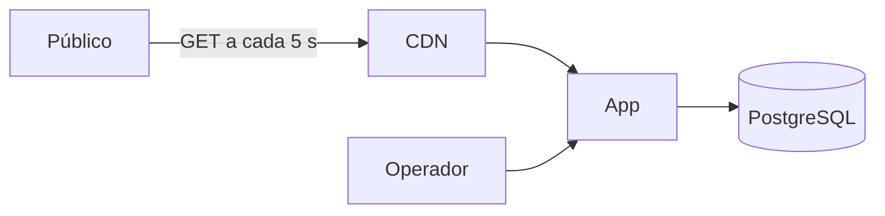
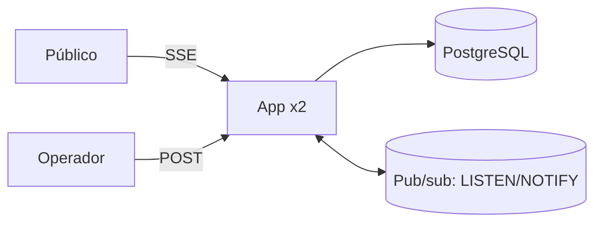
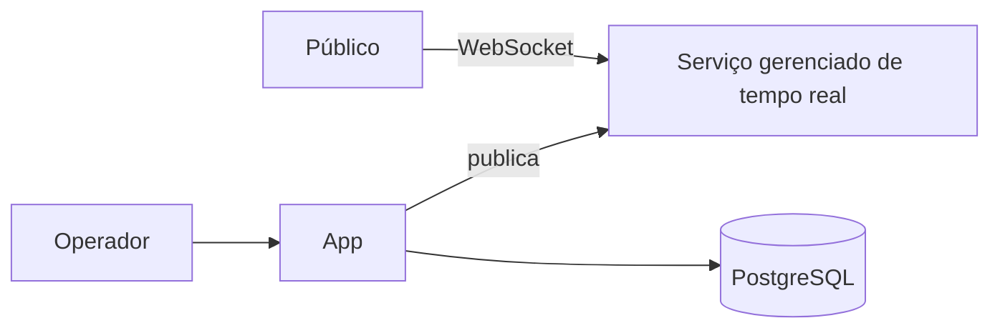
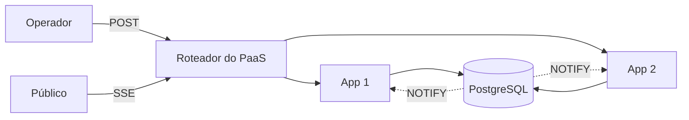

# Caso: Placar ao vivo "Lance"

Produto fictício. Placar ao vivo de partidas de futebol amador e de base: um operador no campo registra gols e cartões pelo celular, e o público acompanha numa página que atualiza sozinha. O problema que o caso ensina: entregar a mesma atualização para muita gente ao mesmo tempo (fan-out), e escolher entre Server-Sent Events e WebSocket.

## Brief

- Partidas simultâneas: até 200 nos fins de semana (fornecido).
- Público: em média 100 pessoas por partida, até 20.000 numa final (fornecido).
- Atualizações: cerca de 30 eventos por partida (gols, cartões, substituições, início e fim) (inferido de súmulas).
- Latência: o público vê o gol em até 2 segundos depois do registro (fornecido).
- Comunicação: o público só recebe; só o operador envia (fornecido).
- Equipe: uma pessoa (fornecido).
- Orçamento: até 40 dólares por mês (fornecido).
- Alvo de infraestrutura: "ainda não sei" na entrevista; recomendado PaaS pela equipe de uma pessoa (inferido).

### Estimativa de capacidade

- Conexões abertas num sábado comum: 200 partidas × 100 pessoas = 20.000 conexões.
- Numa final, somando as outras partidas: 20.000 + 199 × 100 ≈ 40.000 conexões (estimativa).
- Eventos enviados: 200 partidas × 30 eventos ÷ 2 horas ≈ 0,8 evento/s de entrada.
- Mensagens de saída: cada evento vai para todos os espectadores da partida; numa final, 1 evento gera 20.000 mensagens. Em média: 0,8 × 100 = 80 mensagens/s; picos de 20.000 mensagens num instante.
- Memória: com ~20 KB por conexão aberta, 40.000 conexões ≈ 800 MB.

## Opções

Neste documento as opções aparecem como `###` porque estão dentro da seção `## Opções`; no `architecture/options.md` real elas são `##`, como no template.

### Opção A: polling a cada 5 segundos com cache HTTP

### Opção B: Server-Sent Events com pub/sub entre instâncias

### Opção C: WebSocket com serviço de tempo real gerenciado

| Opção | Custo mensal (faixa) | Complexidade operacional | Pontos únicos de falha | Se a carga dobrar | Deixa de servir quando |
| --- | --- | --- | --- | --- | --- |
| A | 5 a 20 dólares | Baixa: só HTTP e CDN | A app (a CDN segura as leituras) | A CDN absorve | Atraso de até 5 s viola o alvo de 2 s |
| B | 15 a 40 dólares | Média: conexões longas e pub/sub | O banco usado como pub/sub | Mais instâncias; o pub/sub espalha | Conexões acima do que as instâncias aguentam em memória |
| C | 30 a 150 dólares, por conexão | Baixa a média: serviço de terceiro | O serviço de terceiro | O serviço escala | Custo por conexão passa do orçamento |

### Recomendação

Opção B, recomendada. O alvo de 2 segundos elimina o polling de 5 segundos. A comunicação é de mão única, então Server-Sent Events basta e é mais simples de escalar que WebSocket (HTTP comum, reconexão automática). O pub/sub usa o `LISTEN/NOTIFY` do PostgreSQL que já existe, sem um serviço novo, porque a entrada é de menos de 1 evento/s. A opção C fica como estágio futuro.

## Contrato

## 1. Contexto e atributos de qualidade

Placar ao vivo de partidas amadoras. Até 40.000 conexões abertas numa final, atualização em até 2 s, entrada de menos de 1 evento/s. Comunicação de mão única para o público. Equipe de uma pessoa.

## 2. Componentes e fronteiras

App única em PaaS com duas instâncias: API do operador e endpoint SSE `/partidas/{id}/eventos`. PostgreSQL gerenciado. Regra: o endpoint SSE só lê eventos; só a API do operador escreve.

## 3. Dados

PostgreSQL (ADR de exemplo: PostgreSQL também como pub/sub via `LISTEN/NOTIFY`, em vez de Redis, pela entrada baixa). Tabela `match_events` só de inserção, com número de sequência por partida. Backup diário do provedor; RPO 24 h, RTO 4 h.

- Migrações: no comando de release do PaaS, antes da nova versão receber tráfego; só aditivas durante os fins de semana de jogos.

## 4. Cache

Placar atual de cada partida em memória em cada instância, atualizado pela notificação. Página inicial da partida servida com `Cache-Control: max-age=5` pela CDN; as atualizações seguintes chegam pelo SSE.

## 5. Comunicação

O operador envia eventos por POST, com chave de idempotência gerada no celular (rede ruim no campo provoca reenvio). A app grava o evento e emite `NOTIFY partida_<id>`. Cada instância escuta e repassa aos espectadores conectados daquela partida. O cliente SSE envia `Last-Event-ID` ao reconectar e recebe os eventos que perdeu pelo número de sequência.

- Garantia de entrega: pelo menos uma vez do operador para a app (o celular reenvia com a mesma chave de idempotência); da app para o público, no máximo uma vez por conexão, com recuperação pelo `Last-Event-ID` ao reconectar, porque os eventos ficam no banco.

## 6. Deploy e infraestrutura

PaaS com duas instâncias e o banco gerenciado do próprio PaaS. Timeout de conexão do proxy do PaaS conferido para conexões longas; heartbeat SSE a cada 15 segundos. Deploy com rolling update; os clientes reconectam sozinhos.

- Ambientes: local e produção, mais um app de preview do PaaS por pull request (ADR de exemplo: PaaS em vez de VPS, porque a equipe é de uma pessoa).
- Caminho até produção: push na branch principal → CI com testes → o PaaS gera a imagem, roda a migração no release e troca as instâncias uma a uma; rollback pelo painel do PaaS para o release anterior.

## 7. Observabilidade

Logs JSON com id de correlação. Métricas: conexões SSE abertas por instância, atraso entre o registro e o envio, eventos por segundo. Alertas: atraso p95 > 2 s por 5 minutos; conexões por instância > 15000 conexões.

## 8. Segurança e permissões

Operadores autenticados com conta e vinculados às partidas que podem editar (permissão por recurso). Público anônimo, só leitura. Rate limiting na API do operador. Segredos nas variáveis do PaaS. Ver regra `08-security-engineering`.

- Portas expostas: só o 443 do roteador do PaaS; o banco gerenciado aceita conexões apenas da rede privada do PaaS.

## 9. Estágios de escala

### Estágio 0: SSE com LISTEN/NOTIFY (atual)
- Mudança: desenho acima.

### Estágio 1: mais instâncias e Redis como pub/sub
- Gatilho: conexões abertas > 30000 conexões por instância no pico de 3 dias (fonte: métrica da app)
- Mudança: quatro ou mais instâncias; Redis pub/sub no lugar do `LISTEN/NOTIFY`
- Custo: um serviço a mais para operar
- Pré-requisito: nenhum estado de partida só em memória que não possa ser refeito do banco

### Estágio 2: serviço de tempo real gerenciado
- Gatilho: atraso p95 entre registro e entrega > 2000 ms por 7 dias com o estágio 1 ativo (fonte: métrica da app)
- Mudança: a app publica no serviço gerenciado; o público conecta nele
- Custo: custo por conexão e dependência de terceiro
- Pré-requisito: autenticação do canal do operador separada do canal público

## 10. Anti-padrões

- Não usar WebSocket para uma comunicação que é só do servidor para o cliente.
- Não manter conexões sem heartbeat atrás de proxy.
- Não guardar o placar só em memória sem os eventos no banco.

## O que este caso ensina

1. O custo do tempo real está no número de conexões abertas e no fan-out, não na entrada de dados.
2. Server-Sent Events atende comunicação de mão única com menos custo que WebSocket.
3. Com várias instâncias, é preciso um pub/sub entre elas; o banco que já existe pode servir enquanto a entrada é baixa.
4. Reconexão com o último evento recebido evita perder um gol numa queda de rede.
