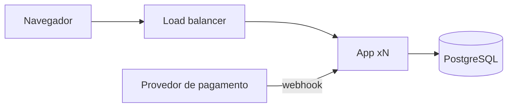
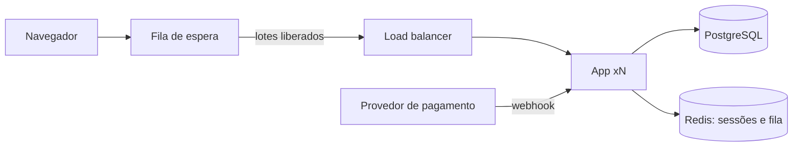
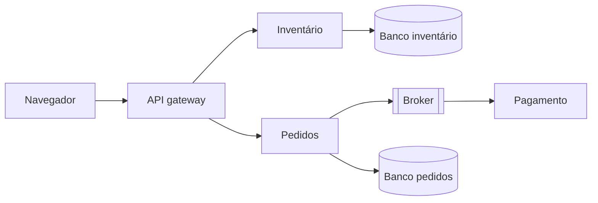
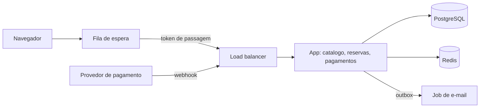

# Caso: Venda de ingressos "Plateia"

Produto fictício. Venda de ingressos para shows com lugar marcado. O problema que o caso ensina: um pico curto e enorme na abertura da venda, e duas pessoas tentando comprar a mesma cadeira.

## Brief

- Eventos: 30 eventos por mês, cada um com até 20.000 lugares (fornecido).
- Pico: na abertura de um evento grande, 100.000 pessoas chegam nos primeiros 10 minutos (fornecido pela equipe comercial).
- Fora dos picos: cerca de 5 req/s (observado: logs do site atual).
- Consistência: uma cadeira nunca pode ser vendida duas vezes; o mapa de lugares pode atrasar alguns segundos (fornecido).
- Reserva: quem escolhe a cadeira tem 8 minutos para pagar (fornecido).
- Pagamento: provedor externo com webhook (observado: integração atual).
- Equipe: quatro pessoas, uma com experiência de operação (fornecido).
- Orçamento: até 400 dólares por mês, aceitando custo maior nos dias de abertura (fornecido).
- Alvo de infraestrutura: cloud gerenciada com containers (fornecido).

### Estimativa de capacidade

- Pessoas no pico: 100.000 em 10 minutos ≈ 167 chegadas/s.
- Cada pessoa faz em média 15 requisições até pagar (mapa, escolha, reserva, pagamento, consultas de status): 167 × 15 ≈ 2.500 req/s no pico (estimativa).
- Tentativas de reserva: cada pessoa tenta em média 3 cadeiras ≈ 500 tentativas/s disputando 20.000 linhas.
- Fora do pico: 5 req/s. A diferença entre pico e média é de 500 vezes: o desenho é dimensionado pelo pico.
- Armazenamento: 30 eventos × 20.000 lugares × 12 meses ≈ 7.200.000 ingressos por ano, menos de 5 GB.

## Opções

Neste documento as opções aparecem como `###` porque estão dentro da seção `## Opções`; no `architecture/options.md` real elas são `##`, como no template.

### Opção A: monólito com escala horizontal e reserva no banco

### Opção B: fila de espera na frente, reserva no banco

### Opção C: serviços separados de inventário, pedidos e pagamento com eventos

| Opção | Custo mensal (faixa) | Complexidade operacional | Pontos únicos de falha | Se a carga dobrar | Deixa de servir quando |
| --- | --- | --- | --- | --- | --- |
| A | 150 a 400 dólares | Média: autoscaling e banco gerenciado | O banco primário | Mais instâncias; o banco recebe toda a disputa | Raramente por carga: um PostgreSQL gerenciado aguenta as 500 reservas/s; o problema é escalar 20 instâncias e as conexões ao banco por 10 minutos, e a experiência ruim de conflito em massa nas mesmas cadeiras |
| B | 200 a 500 dólares | Média: fila de espera e Redis | Banco primário; Redis | Aumenta a espera, não a carga no banco | Raramente; o ritmo de liberação controla a carga |
| C | 600 a 1.500 dólares | Alta: vários serviços, broker, saga | O broker | Escala por serviço | Por custo e por equipe antes de carga |

### Recomendação

Opção B, recomendada. O item do brief que exige a fila de espera é o pico de 100.000 pessoas em 10 minutos contra 5 req/s normais: escalar app e conexões ao banco para 2.500 req/s por 10 minutos custa caro, e deixar 100.000 pessoas disputarem as mesmas cadeiras ao mesmo tempo produz conflitos em massa e uma experiência ruim. As 500 reservas condicionais por segundo, sozinhas, cabem num PostgreSQL gerenciado; a fila libera pessoas num ritmo que mantém conexões, custo e conflitos sob controle. A opção C adiciona serviços e saga sem um item do brief que os exija, para uma equipe de quatro.

## Contrato

## 1. Contexto e atributos de qualidade

Venda de ingressos com lugar marcado. Pico de 167 chegadas/s e ~2.500 req/s por 10 minutos na abertura; 5 req/s no resto do tempo. Invariante: nenhuma cadeira vendida duas vezes. Reserva expira em 8 minutos. Disponibilidade alvo de 99,9% durante aberturas.

## 2. Componentes e fronteiras

Fila de espera (página estática e contador no Redis), app monolítica com os módulos `catalogo`, `reservas` e `pagamentos`, PostgreSQL gerenciado, Redis gerenciado. Regra: só `reservas` escreve na tabela `seats`; `pagamentos` confirma pela interface pública de `reservas`.

## 3. Dados

PostgreSQL (ADR de exemplo: reserva com `UPDATE seats SET status='held', held_until=now()+'8 min' WHERE id=$1 AND status='free'`, sem lock distribuído). A atualização condicional garante uma única reserva por cadeira. Um job libera reservas vencidas a cada 30 segundos. Backup contínuo do provedor; RPO 5 min, RTO 30 min.

- Migrações: num passo separado antes do deploy, nunca durante uma abertura de vendas; compatíveis com a versão anterior (expandir e depois contrair).

## 4. Cache

Mapa de lugares servido do Redis com TTL de 3 segundos, porque o brief aceita atraso de segundos. Disponibilidade final sempre conferida no banco na hora da reserva. Nada de pagamento ou permissão em cache.

## 5. Comunicação

Reserva e consulta síncronas. Webhook do provedor de pagamento é idempotente pela chave do pagamento (tabela `processed_payments` com restrição única). E-mail do ingresso enviado por job a partir de uma tabela outbox gravada na mesma transação da confirmação.

- Garantia de entrega: pelo menos uma vez para o webhook de pagamento (o provedor reenvia) e para o e-mail do ingresso (o relay da outbox pode publicar de novo); os dois consumidores são idempotentes, pela chave do pagamento e pelo id do ingresso. Três tentativas com backoff; depois, fila de falhas com alerta.

## 6. Deploy e infraestrutura

Containers gerenciados com autoscaling da app (mínimo 2, máximo 20 instâncias); escala prévia programada 15 minutos antes de cada abertura. Banco e Redis gerenciados em rede privada. Staging com os mesmos templates. Teste de carga em staging antes de cada evento grande.

- Ambientes: local, staging (mesmos templates, menor, dados anonimizados) e produção (ADR de exemplo: containers gerenciados em vez de Kubernetes, porque um serviço com autoscaling atende e a equipe tem uma pessoa de operação).
- Caminho até produção: pull request → CI com testes e `lint_infra.py` → imagem com o hash do commit → deploy em staging e teste de fumaça → deploy em produção com rolling update fora das janelas de abertura; rollback = versão anterior do serviço.

## 7. Observabilidade

Logs JSON com id de correlação, incluindo o id da reserva. RED da app; USE do banco, com atenção a conexões e locks. Métrica de negócio: reservas por segundo, conflitos por segundo, tamanho da fila de espera. Alertas: p95 da reserva > 500 ms por 2 minutos; taxa de erro > 2% por 2 minutos.

## 8. Segurança e permissões

Compradores com conta e sessão; administradores de evento com RBAC (`organizador`, `suporte`, `admin`). Webhook validado por assinatura. Rate limiting por conta e por IP na reserva, contra robôs. Token de passagem da fila de espera assinado e com validade. Segredos no secret manager do provedor. Ver regra `08-security-engineering`.

- Portas expostas: 443 no load balancer e na página da fila de espera; app, PostgreSQL e Redis só na rede privada.
- Autorização: RBAC para a área administrativa (ADR de exemplo: RBAC em vez de ABAC, com três papéis fixos).

## 9. Estágios de escala

### Estágio 0: fila de espera e monólito escalável (atual)
- Mudança: desenho acima.

### Estágio 1: réplica de leitura para catálogo e mapa
- Gatilho: CPU do banco primário > 70% durante aberturas em 3 dias de abertura seguidos (fonte: métricas do banco)
- Mudança: catálogo e mapa leem da réplica; reservas continuam no primário
- Custo: uma instância de banco a mais; atraso de réplica de até 1 s no mapa
- Pré-requisito: consultas de status da própria reserva ficam no primário

### Estágio 2: inventário particionado por evento
- Gatilho: tentativas de reserva > 3000 req/s num único evento (fonte: métrica de negócio)
- Mudança: cadeiras de cada evento grande em uma partição ou banco próprio
- Custo: roteamento por evento e relatórios entre partições
- Pré-requisito: nenhuma transação entre eventos diferentes

## 10. Anti-padrões

- Não usar "ler e depois gravar" para reservar uma cadeira: sempre a atualização condicional.
- Não processar webhook de pagamento sem chave de idempotência.
- Não liberar todas as pessoas da fila de espera de uma vez.

## O que este caso ensina

1. Quando o pico é centenas de vezes a média, controlar a entrada (fila de espera) sai mais barato do que escalar tudo.
2. Uma atualização condicional no banco resolve a disputa pela mesma cadeira sem lock distribuído.
3. Reserva com expiração precisa de um job que libere o que venceu.
4. Webhook de pagamento chega mais de uma vez; idempotência é obrigatória.
5. Microsserviços com saga resolvem um problema que este brief não tem.
