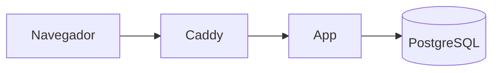
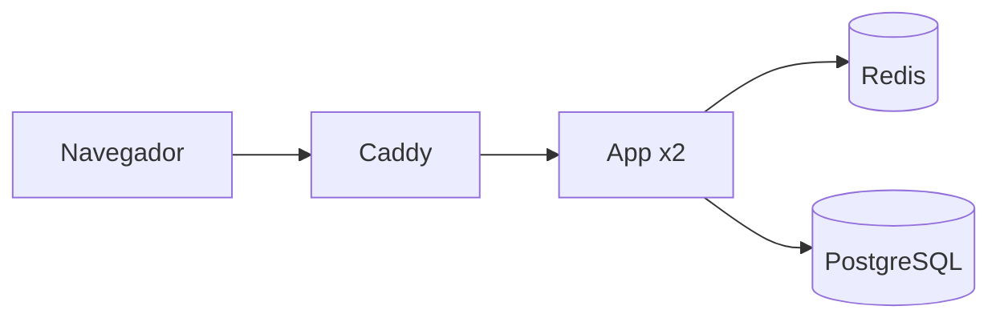
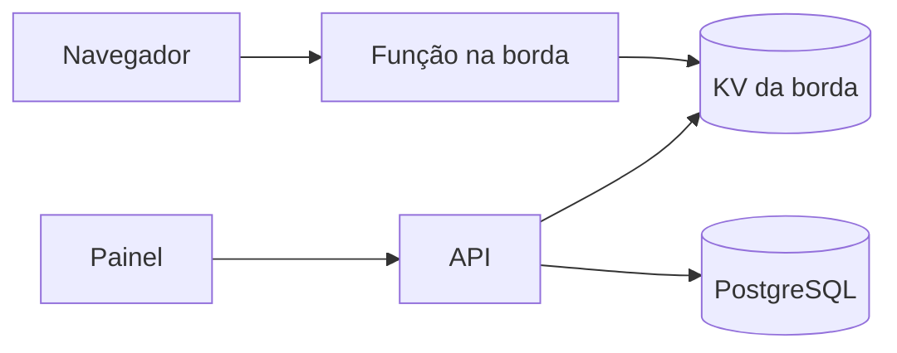
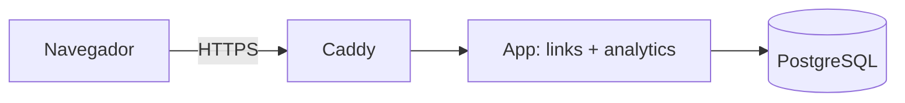

# Caso: Encurtador de links "Curto"

Produto fictício. Um encurtador de links para equipes de marketing: o usuário cola uma URL longa, recebe `curto.app/a8Kq2` e acompanha quantos cliques o link teve. O problema que o caso ensina: a leitura é muito maior que a escrita, e o redirecionamento precisa ser rápido.

## Brief

- Usuários: 2.000 contas ativas por mês hoje, 20.000 em 12 meses (fornecido).
- Escrita: cada conta cria em média 50 links por mês (fornecido).
- Leitura: cada link recebe em média 200 cliques no total, a maior parte nos primeiros 3 dias (inferido de produtos parecidos).
- Pico: campanhas concentram cliques; pico de 10 vezes a média (inferido).
- Latência: redirecionamento p95 abaixo de 50 ms no servidor (fornecido).
- Consistência: um link novo precisa funcionar na hora; a contagem de cliques pode atrasar alguns minutos (fornecido).
- Equipe: duas pessoas, experiência com Linux e PostgreSQL (fornecido).
- Orçamento: até 60 dólares por mês (fornecido).
- Alvo de infraestrutura: VPS (fornecido).

### Estimativa de capacidade

Em 12 meses (premissas acima):

- Links novos por mês: 20.000 contas × 50 = 1.000.000. Por segundo: 1.000.000 ÷ (30 × 86.400) ≈ 0,4 escrita/s.
- Cliques por mês: 1.000.000 links × 200 = 200.000.000. Por segundo em média: 200.000.000 ÷ 2.592.000 ≈ 77 req/s.
- Pico: 77 × 10 ≈ 770 req/s de redirecionamento (estimativa, depende do fator de pico inferido).
- Proporção leitura/escrita: cerca de 200 para 1.
- Armazenamento dos links: 1.000.000 × 12 meses × ~500 bytes ≈ 6 GB por ano.
- Eventos de clique, se guardados um a um: 200.000.000 × 12 × ~100 bytes ≈ 240 GB por ano. Por isso os cliques são agregados por link e por hora.

## Opções

Neste documento as opções aparecem como `###` porque estão dentro da seção `## Opções`; no `architecture/options.md` real elas são `##`, como no template.

### Opção A: monólito com PostgreSQL e cache em processo

### Opção B: monólito com Redis para links e contadores

### Opção C: redirecionamento na borda (CDN com função) e API separada

| Opção | Custo mensal (faixa) | Complexidade operacional | Pontos únicos de falha | Se a carga dobrar | Deixa de servir quando |
| --- | --- | --- | --- | --- | --- |
| A | 10 a 25 dólares | Baixa: um servidor, um banco | O servidor | Máquina maior; cache em processo segura as leituras | Pico acima de ~2.000 req/s ou mais de uma instância necessária |
| B | 30 a 60 dólares | Média: Redis para operar e invalidar | Redis sem réplica | Mais instâncias da app atrás do Caddy | Contadores e links não cabem na memória do Redis |
| C | 20 a 80 dólares, variável por requisição | Média a alta: dois runtimes, sincronização com a borda | O provedor da borda | Sem mudança na borda | Raramente por carga; por custo por requisição |

### Recomendação

Opção A, recomendada. 770 req/s de pico em redirecionamento por chave primária, com cache em processo dos links quentes, cabe numa VPS média. A equipe já opera PostgreSQL, e o orçamento é baixo. Redis e borda ficam como estágios futuros com gatilho.

## Contrato

## 1. Contexto e atributos de qualidade

Encurtador de links para equipes de marketing. Redirecionamento p95 < 50 ms no servidor, pico estimado de 770 req/s em 12 meses, leitura/escrita de 200 para 1. Disponibilidade alvo 99,5% ao mês. Contagem de cliques pode atrasar até 5 minutos.

## 2. Componentes e fronteiras

Um monólito com dois módulos: `links` (criação e resolução) e `analytics` (contagem). O Caddy termina TLS e encaminha. Regra: `analytics` não lê as tabelas de `links`; recebe o id do link no evento de clique.

## 3. Dados

PostgreSQL (ADR de exemplo: PostgreSQL em vez de banco chave-valor, porque o painel precisa de consultas por conta e período). Tabela `links` com índice único no código curto. Cliques agregados em `click_counts (link_id, hora, total)`. Código curto gerado com 7 caracteres base62 aleatórios e restrição de unicidade, com nova tentativa em colisão. Backup diário com retenção de 14 dias; RPO 24 h, RTO 2 h.

- Migrações: com a ferramenta do framework, num passo do deploy antes da nova versão receber tráfego; toda migração funciona com a versão anterior da app (expandir e depois contrair).

## 4. Cache

Cache em processo (LRU de 100.000 links) do código curto para a URL de destino, TTL de 10 minutos. Links não mudam de destino depois de criados; desativar um link apaga a chave na instância e o TTL cobre o resto.

## 5. Comunicação

Redirecionamento síncrono. O clique é registrado de forma assíncrona: a app acumula contagens em memória e grava em lote a cada 30 segundos. Perder até 30 segundos de contagem numa queda é aceito pelo brief; não há fila.

- Garantia de entrega: no máximo uma vez para a contagem de cliques (o lote em memória pode se perder numa queda, até 30 s, aceito pelo brief); o redirecionamento é síncrono e não depende do lote.

## 6. Deploy e infraestrutura

Uma VPS com Docker Compose: `caddy`, `app` e `postgres`. Imagens com tag fixa, usuário não root, healthcheck. Ambientes: local e produção. CI roda testes e `lint_infra.py`, gera a imagem com o hash do commit e faz o deploy por SSH.

- Ambientes: local (Compose com dados de teste) e produção; sem staging, porque a equipe é de duas pessoas e a app é uma só (ADR de exemplo: VPS com Compose em vez de PaaS, pelo orçamento e pela experiência da equipe).
- Caminho até produção: push na branch principal → CI com testes e `lint_infra.py` → imagem com o hash do commit no registry → deploy por SSH com `docker compose pull && docker compose up -d` → migração → verificação do healthcheck; rollback = subir a imagem anterior.

## 7. Observabilidade

Logs JSON com id de correlação. Métricas RED do redirecionamento e da API; USE da VPS e do banco. Alertas: p95 de redirecionamento > 50 ms por 10 minutos; taxa de erro > 1% por 5 minutos.

## 8. Segurança e permissões

Contas com e-mail e senha e sessão em cookie. Autorização por dono do link. URLs de destino passam por lista de bloqueio contra phishing. Rate limiting na criação de links. Segredos em `env_file` fora do repositório. Só as portas 80 e 443 expostas. Ver regra `08-security-engineering`.

- Portas expostas: 80 e 443 no Caddy; PostgreSQL só na rede interna do Compose, sem porta publicada; SSH com chave, restrito por firewall.
- Autorização: por dono do recurso (ADR de exemplo: dono do link em vez de RBAC, porque não há papéis além de dono e administrador).

## 9. Estágios de escala

### Estágio 0: monólito numa VPS (atual)
- Mudança: desenho acima.

### Estágio 1: Redis para links quentes e contadores
- Gatilho: p95 de redirecionamento > 50 ms por 7 dias com cache em processo ativo (fonte: métricas da app)
- Mudança: Redis compartilhado para links e contadores; duas instâncias da app atrás do Caddy
- Custo: um serviço a mais; invalidação passa a ser distribuída
- Pré-requisito: contagens de clique fora da memória do processo

### Estágio 2: redirecionamento na borda
- Gatilho: pico de redirecionamento > 3000 req/s por 3 dias (fonte: métricas do Caddy)
- Mudança: função na borda resolve o código curto a partir de um KV sincronizado pela API
- Custo: custo por requisição e um segundo runtime
- Pré-requisito: eventos de clique enviados da borda para a API em lote

## 10. Anti-padrões

- Não guardar cada clique como uma linha.
- Não gerar código curto sequencial (permite enumerar links).
- Não adicionar fila ou Redis antes do gatilho do estágio 1.

## O que este caso ensina

1. Quando a leitura domina, o cache em processo resolve muito antes de um cache distribuído.
2. Agregar eventos de alto volume (cliques por hora) evita centenas de GB por ano.
3. A tolerância a atraso registrada no brief permite gravar em lote sem fila.
4. Código curto aleatório com restrição de unicidade é mais simples do que um gerador de id distribuído.
