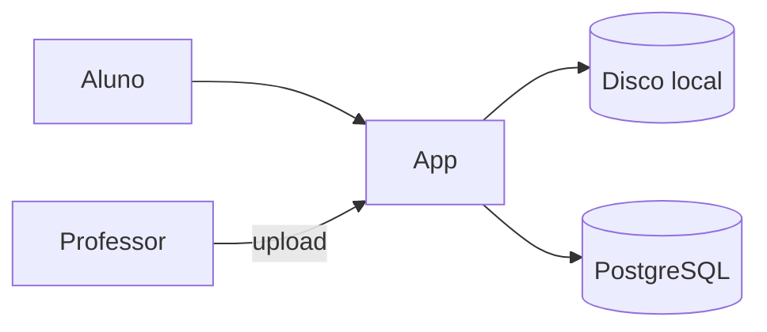
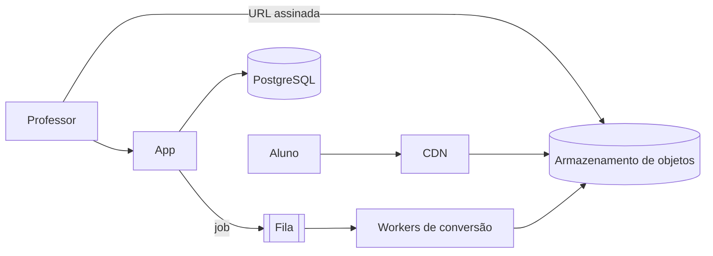
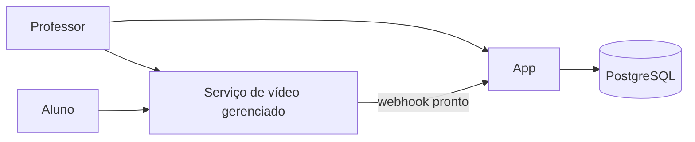
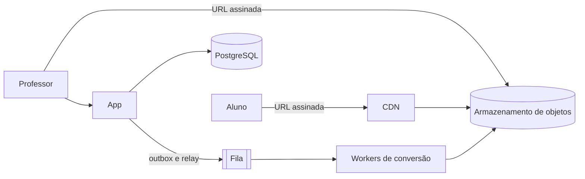

# Caso: Plataforma de vídeo "Aula Aberta"

Produto fictício. Plataforma de cursos em vídeo: professores enviam aulas gravadas e alunos assistem no navegador e no celular. O problema que o caso ensina: upload de arquivo grande, processamento lento e assíncrono, armazenamento de objetos e entrega por CDN.

## Brief

- Professores: 500 hoje, 3.000 em 12 meses, cada um envia 8 vídeos por mês de 20 minutos em média (fornecido).
- Alunos: 50.000 ativos por mês em 12 meses, assistindo em média 10 horas por mês (fornecido).
- Tamanho do original: cerca de 1,5 GB por vídeo de 20 minutos (observado: amostra de uploads).
- Processamento: o vídeo pode ficar disponível até 30 minutos depois do upload (fornecido).
- Reprodução: começar em até 3 segundos e adaptar à conexão do aluno (fornecido).
- Acesso: só alunos matriculados assistem ao curso (fornecido).
- Equipe: três pessoas (fornecido).
- Orçamento: até 6.000 dólares por mês em 12 meses, dominado pela banda (fornecido).
- Alvo de infraestrutura: VPS para a app e serviços gerenciados para armazenamento e CDN (fornecido).

### Estimativa de capacidade

Em 12 meses:

- Uploads: 3.000 × 8 = 24.000 vídeos por mês ≈ 800 por dia.
- Armazenamento novo dos originais: 24.000 × 1,5 GB = 36 TB por mês. Por isso o original é apagado depois da conversão (premissa a confirmar).
- Versões convertidas (1080p, 720p, 480p), cerca de 0,6 GB juntas por vídeo: 24.000 × 0,6 ≈ 14 TB por mês, 173 TB por ano.
- Banda de saída: 50.000 alunos × 10 h × ~1 GB por hora em 720p ≈ 500 TB por mês. A banda é o maior custo; preço por TB da CDN decide o orçamento.
- Processamento: converter 20 minutos leva cerca de 10 minutos de CPU de um worker com 4 núcleos. 800 vídeos/dia × 10 min ≈ 133 h de worker por dia ≈ 6 workers contínuos (estimativa).
- API: 50.000 alunos, poucas requisições por aula; abaixo de 50 req/s no pico.

## Opções

Neste documento as opções aparecem como `###` porque estão dentro da seção `## Opções`; no `architecture/options.md` real elas são `##`, como no template.

### Opção A: app numa VPS, conversão na mesma máquina

### Opção B: upload direto para armazenamento de objetos, fila e workers de conversão

### Opção C: serviço gerenciado de vídeo

| Opção | Custo mensal (faixa) | Complexidade operacional | Pontos únicos de falha | Se a carga dobrar | Deixa de servir quando |
| --- | --- | --- | --- | --- | --- |
| A | 50 a 150 dólares sem banda | Baixa no início; alta logo depois | A VPS e o disco local | O disco enche e a conversão trava a app | Dezenas de uploads por dia |
| B | 3.000 a 6.000 dólares, dominado pela banda (500 TB a 5–10 dólares por TB em contrato de volume) | Média: fila, workers, URLs assinadas | O banco; a fila sem réplica | Mais workers; a CDN absorve a banda | Raramente por carga; ajusta-se o número de workers |
| C | 10.000 a 25.000 dólares, por minuto armazenado e assistido | Baixa | O fornecedor | O fornecedor escala | O custo por minuto passa do orçamento |

### Recomendação

Opção B, recomendada. A fila e os workers são exigidos pelo brief: conversão de ~10 minutos por vídeo não cabe no caminho da requisição, e 800 vídeos por dia precisam de ~6 workers. Armazenamento de objetos e CDN são exigidos pelos 173 TB por ano e 500 TB por mês de saída. A opção C seria mais simples, mas a faixa de custo passa do orçamento.

## Contrato

## 1. Contexto e atributos de qualidade

Cursos em vídeo para 50.000 alunos ativos em 12 meses. 800 uploads por dia de ~1,5 GB; vídeo disponível em até 30 minutos; reprodução começa em até 3 s com bitrate adaptativo. Só matriculados assistem. A banda de saída (~500 TB por mês) domina o custo.

## 2. Componentes e fronteiras

App (API e painel) numa VPS; workers de conversão em máquinas separadas; armazenamento de objetos; CDN; fila; PostgreSQL gerenciado. Regra: a app nunca recebe o arquivo de vídeo; o upload vai direto ao armazenamento por URL assinada. Só os workers escrevem as versões convertidas.

## 3. Dados

PostgreSQL para cursos, matrículas e o estado de cada vídeo (`enviado`, `convertendo`, `pronto`, `falhou`). Vídeos no armazenamento de objetos, com o original apagado 7 dias depois da conversão (ADR de exemplo: apagar o original para limitar o armazenamento). Backup do banco diário; RPO 24 h, RTO 4 h. Os vídeos convertidos têm a durabilidade do armazenamento de objetos.

- Migrações: num passo do deploy antes da nova versão da app e dos workers; compatíveis com a versão anterior, porque app e workers são atualizados em momentos diferentes.

## 4. Cache

Segmentos de vídeo (HLS) cacheados na CDN com TTL longo, porque não mudam depois de gerados. Playlists com TTL curto. Nenhuma resposta da API com dado de matrícula em cache compartilhado.

## 5. Comunicação

O professor pede uma URL assinada, envia em partes (multipart) direto ao armazenamento e avisa a app. A app grava o vídeo como `enviado` e o job na tabela outbox na mesma transação; um relay publica na fila. Workers são idempotentes pelo id do vídeo (se as versões já existem, só marcam `pronto`). Três tentativas com backoff; depois, dead letter queue e estado `falhou` com aviso ao professor.

- Garantia de entrega: pelo menos uma vez da outbox para a fila e da fila para os workers; idempotência pelo id do vídeo. Três tentativas com backoff; depois, dead letter queue.

## 6. Deploy e infraestrutura

App numa VPS com Docker Compose; workers em VPS separadas, também com Compose, escaláveis pelo tamanho da fila. Armazenamento de objetos e CDN gerenciados. Imagens com tag fixa, usuário não root, limites de CPU e memória nos workers. CI com `lint_infra.py`.

- Ambientes: local (Compose com armazenamento compatível local), staging com um bucket separado e produção (ADR de exemplo: VPS para app e workers em vez de containers gerenciados, pelo orçamento).
- Caminho até produção: pull request → CI com testes e `lint_infra.py` → imagens da app e do worker com o hash do commit → deploy em staging com um vídeo de teste → deploy em produção, primeiro os workers e depois a app; rollback = imagens anteriores.

## 7. Observabilidade

Logs JSON com id de correlação que segue do upload ao worker. Métricas: tamanho da fila, tempo de conversão p95, falhas por hora, banda da CDN por dia. Alertas: vídeos `convertendo` há mais de 30 minutos; dead letter queue com mais de 0 itens por 1 h.

## 8. Segurança e permissões

RBAC com `aluno`, `professor` e `admin`, mais permissão por recurso (professor só edita os próprios cursos). Reprodução por URLs assinadas da CDN com validade de 4 horas, emitidas só para matriculados. URLs de upload com validade de 1 hora e tamanho máximo. Workers com credencial que só lê originais e escreve versões. Segredos fora do repositório. Ver regra `08-security-engineering`.

- Portas expostas: 443 na VPS da app; workers sem porta de entrada, só saída para fila e armazenamento; banco e fila em rede privada.

## 9. Estágios de escala

### Estágio 0: fila, workers e CDN (atual)
- Mudança: desenho acima, com 6 workers.

### Estágio 1: workers com autoscaling
- Gatilho: vídeos esperando na fila há mais de 30 minutos em 5 dias de um mês (fonte: métrica da fila)
- Mudança: workers em instâncias criadas e removidas pelo tamanho da fila
- Custo: automação de provisionamento; instâncias sob demanda mais caras
- Pré-requisito: worker que pode ser interrompido e retomado sem corromper o vídeo

### Estágio 2: segunda CDN ou contrato de banda
- Gatilho: banda de saída > 800 TB por mês por 2 meses (fonte: fatura da CDN)
- Mudança: negociar preço por volume ou usar duas CDNs
- Custo: configuração duplicada e roteamento
- Pré-requisito: URLs assinadas num formato que as duas CDNs aceitem

## 10. Anti-padrões

- Não receber o arquivo de vídeo pela app.
- Não converter vídeo na mesma máquina da API.
- Não servir vídeo do armazenamento sem CDN.
- Não gerar URL de reprodução sem validade.

## O que este caso ensina

1. Arquivo grande vai direto ao armazenamento de objetos por URL assinada, não passa pela app.
2. Trabalho de minutos é assíncrono: fila, workers idempotentes e um estado visível para o usuário.
3. A estimativa mostra que a banda, não a CPU, decide o custo.
4. O outbox garante que todo vídeo enviado gera um job, mesmo se o processo cair.
5. Permissão de reprodução vive na URL assinada, porque a CDN não conhece a matrícula.
